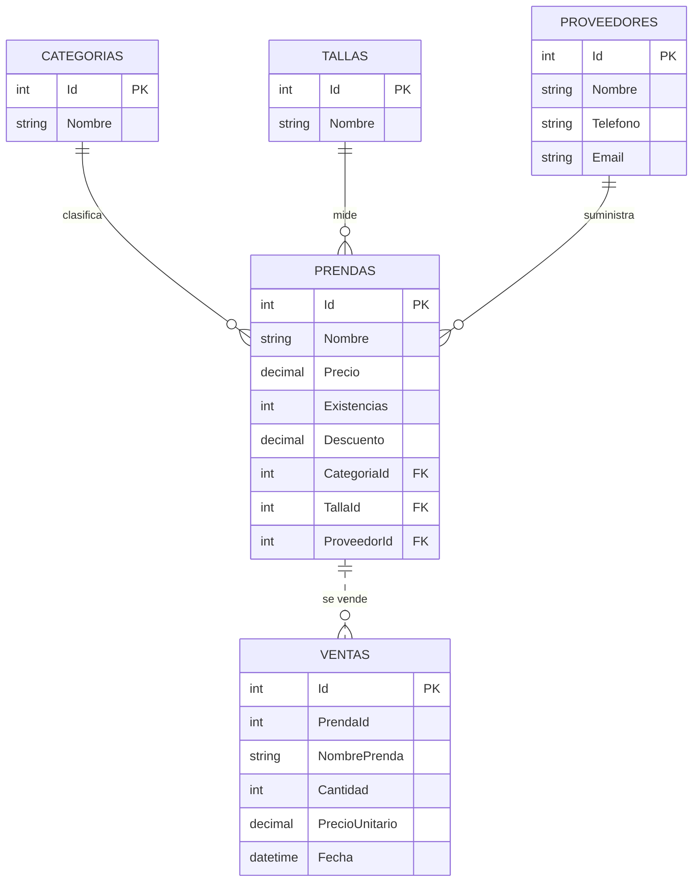

# Registro de Ropa para Boutique (Tarea 4)

Aplicación de consola en C# (.NET 10) para administrar prendas, categorías, tallas y proveedores de una boutique,
con registro de ventas, descuentos y reportes de existencias. Los datos se guardan en **SQL Server 2022 Express**.

## Tecnologías

- C# / .NET 10, programación orientada a objetos
- SQL Server 2022 Express y SQL Server Management Studio
- Paquete `Microsoft.Data.SqlClient`

## Modelo de datos

- Cada prenda pertenece a una categoría, una talla y un proveedor (llaves foráneas).
- `Ventas` guarda el nombre y el precio al momento de la venta y **no** tiene llave foránea hacia `Prendas`,
  para que el historial se conserve aunque la prenda se elimine.
- Reglas en la base: precio mayor que cero, existencias no negativas, descuento entre 0 y 100.

## Cómo ejecutarlo

1. Abrir SQL Server Management Studio, conectarse a `localhost\SQLEXPRESS01` y ejecutar `BoutiqueDB.sql`.
   Crea la base `BoutiqueDB`, las tablas y datos iniciales.
2. Abrir `BoutiqueInventoryApp.slnx` en Visual Studio.
3. Si el nombre de la instancia de SQL Server es distinto, cambiar la cadena de conexión al inicio de `Program.cs`.
4. Ejecutar el proyecto.

## Funciones

- Categorías, tallas y proveedores: agregar, listar, modificar y eliminar.
- Prendas: agregar, listar, buscar (por Id, nombre, categoría, talla, proveedor o rango de precio),
  modificar, eliminar, descuento a una prenda y oferta a toda una categoría.
- Ventas: registrar venta (actualiza el stock y guarda la venta en una sola transacción),
  entrada de mercancía e historial.
- Reportes: stock bajo, valor del inventario y total vendido.
- Validación de todas las entradas y manejo de errores; el programa solo se cierra al elegir **Salir**.

## Estructura del código (`Program.cs`)

| Clase | Responsabilidad |
|---|---|
| `ElementoCatalogo` | Clase base con `Id` y `Nombre` |
| `Categoria`, `Talla`, `Proveedor` | Heredan de `ElementoCatalogo` |
| `Prenda` | Datos de la prenda, validaciones y `PrecioFinal` calculado |
| `Venta` | Registro de una venta |
| `BaseDatos` | Único lugar que ejecuta SQL (consultas con parámetros) |
| `Inventario` | Lógica del negocio, conectada a `BaseDatos` |
| `MenuBoutique` | Menús y entrada/salida por consola |

## Herramientas

Se utilizó Claude (asistente de IA) como apoyo para la guía y revisión del código.
